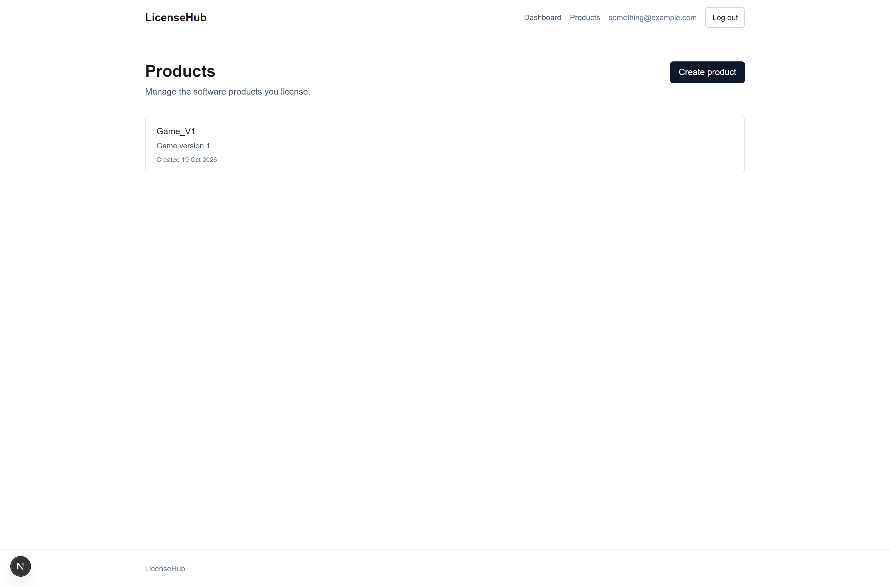
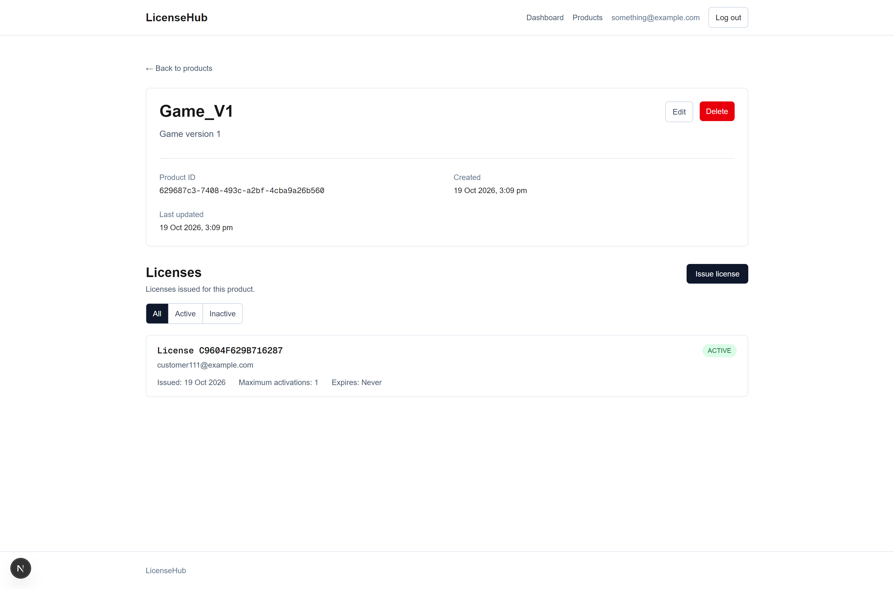
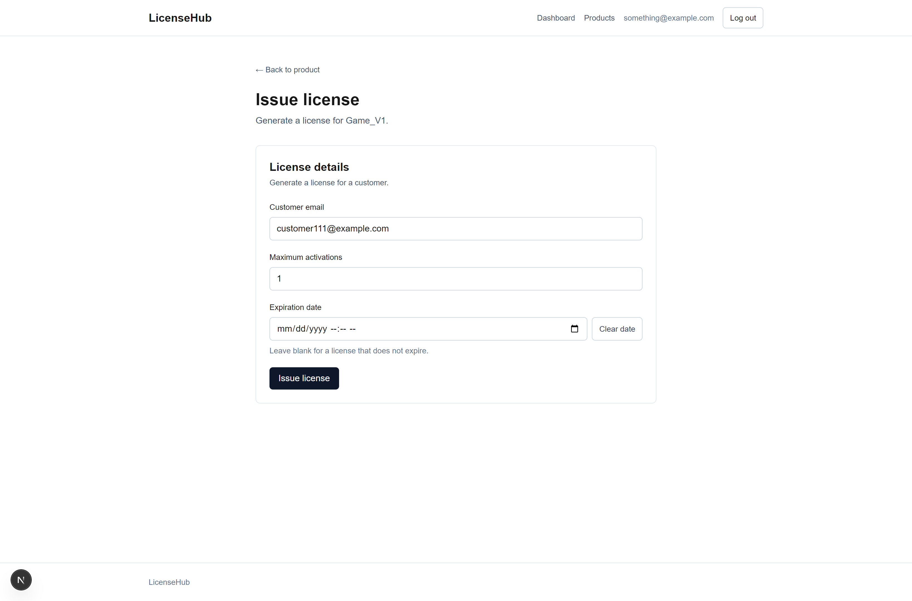
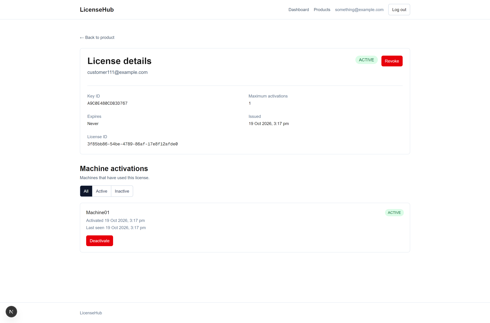
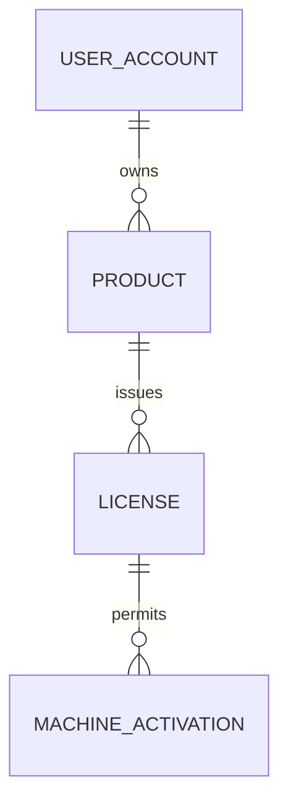

# LicenseHub

[](https://github.com/wengyhong/licensehub/actions/workflows/backend-ci.yml)
[](https://github.com/wengyhong/licensehub/actions/workflows/frontend-ci.yml)

## Overview

LicenseHub is a full-stack SaaS application for issuing software licenses and managing machine activations. It is a learning and portfolio project focused on idiomatic Java and Spring Boot, a modern Next.js frontend, PostgreSQL, automated testing, security, and maintainable application design.

### Features

- User registration and session-based authentication
- CSRF protection for browser clients
- Owner-scoped product management
- Secure software license generation and revocation
- Public machine activation, deactivation, and validation
- Product-bound activation with per-machine activation tokens
- Activation limits with concurrency protection
- Owner-facing activation history and deactivation
- Pagination and Problem Details error responses
- Flyway-managed PostgreSQL schema
- In-memory rate limiting for public activation endpoints
- OpenAPI, Swagger UI, and an Actuator health endpoint
- Unit, MVC slice, repository, and Testcontainers integration tests
- Responsive Next.js management dashboard
- Reusable .NET activation client and interactive console demo
- Unity activation demo with startup validation and a protected-content gate
- Frontend component tests and a full-stack Playwright browser journey
- Docker Compose and separate backend and frontend GitHub Actions pipelines

## Screenshots

| Products | Product details |
|---|---|
|  |  |

| Issue license | License details |
|---|---|
|  |  |

## Technology Stack

- Java 21
- Spring Boot 4.1
- Spring Web MVC
- Spring Data JPA and Hibernate
- Spring Security and Jakarta Bean Validation
- PostgreSQL 18 and Flyway
- Bucket4j and Caffeine
- Springdoc OpenAPI and Spring Boot Actuator
- JUnit 5, Mockito, AssertJ, MockMvc, and Testcontainers
- Maven Wrapper, Docker Compose, and GitHub Actions
- Next.js 16, React 19, TypeScript, and Tailwind CSS
- Vitest, Testing Library, and Playwright
- .NET 10, C#, a `netstandard2.1` client library, and xUnit
- Unity 6 with TextMesh Pro and the Input System

## Architecture

The codebase uses feature-first packages. Each business area keeps its API, application logic, domain model, and persistence code together.

```text
src/main/java/com/weng/licensehub
|-- activation
|   |-- api
|   |-- application
|   |-- domain
|   `-- persistence
|-- license
|-- product
|-- user
`-- shared
    |-- api
    `-- security

frontend/src
|-- app                 Next.js routes, layouts, loading, and error boundaries
|-- components          Shared UI components
|-- features            Auth, product, license, and activation UI/API modules
`-- lib                 Shared API and pagination utilities

clients
|-- LicenseHub.Client         Reusable activation API client (`netstandard2.1`)
|-- LicenseHub.Client.Tests   HTTP-boundary tests for the client
|-- LicenseHub.ActivationDemo Interactive .NET console application
`-- LicenseHub.UnityDemo      Unity activation and protected-content demo
```

The main responsibilities are:

- `api`: REST controllers, request records, and response records
- `application`: use cases, transaction boundaries, and application exceptions
- `domain`: JPA entities and business state transitions
- `persistence`: Spring Data JPA repositories
- `shared`: cross-cutting API and security configuration

Controllers handle HTTP concerns, application services coordinate use cases, domain entities protect state changes, and repositories provide database access.

## Domain Model



### UserAccount

Represents an authenticated LicenseHub account. Email addresses are unique without regard to case, and passwords are stored through Spring Security's delegating password encoder.

### Product

Represents a software product managed by one user account. Product and license-management queries are scoped to the authenticated owner.

### License

A license belongs to a product and records a public key identifier, a hash of the secret, a customer email, a maximum activation count, an optional expiration time, and its status.

The full license key is returned only when the license is issued. It is not stored in recoverable form. The customer email identifies an external recipient and is intentionally not a foreign key to a LicenseHub user.

### MachineActivation

Represents one machine activated against a license. Machine fingerprints and activation tokens are hashed before storage. Deactivation preserves history, and the same machine may later create a new activation.

## API Endpoints

### Authentication

| Method | Path | Access | Description |
|---|---|---|---|
| POST | `/api/auth/register` | Public | Register an account |
| GET | `/api/auth/csrf` | Public | Obtain a CSRF token and session cookie |
| POST | `/api/auth/login` | Public | Authenticate and create a session |
| POST | `/api/auth/logout` | Authenticated | End the current session |
| GET | `/api/auth/me` | Authenticated | Return the current user's email |

### Products

| Method | Path | Description |
|---|---|---|
| POST | `/api/products` | Create a product |
| GET | `/api/products` | List the current user's products |
| GET | `/api/products/{id}` | Get an owned product |
| PUT | `/api/products/{productId}` | Update an owned product |
| DELETE | `/api/products/{productId}` | Delete a product that has no licenses |

### Licenses

| Method | Path | Description |
|---|---|---|
| POST | `/api/products/{productId}/licenses` | Issue a license and return its full key once |
| GET | `/api/products/{productId}/licenses` | List licenses for an owned product |
| GET | `/api/licenses/{licenseId}` | Get an owned license |
| POST | `/api/licenses/{licenseId}/revoke` | Revoke an owned license |

### Public activation API

| Method | Path | Description |
|---|---|---|
| POST | `/api/activations` | Activate a machine |
| POST | `/api/activations/deactivate` | Deactivate the requesting machine |
| POST | `/api/activations/validate` | Validate an active machine and update its last-seen time |

These endpoints do not require a user session. Initial activation requires the license key and the expected product ID. A successful activation returns a per-machine activation token; subsequent validation and deactivation requests use that token, the product ID, and the machine fingerprint instead of repeatedly transmitting the license key.

### Activation management

| Method | Path | Description |
|---|---|---|
| GET | `/api/licenses/{licenseId}/activations` | List activation history for an owned license |
| POST | `/api/licenses/{licenseId}/activations/{activationId}/deactivate` | Deactivate a machine as the product owner |

### Operations and documentation

| Method | Path | Description |
|---|---|---|
| GET | `/actuator/health` | Application health |
| GET | `/v3/api-docs` | OpenAPI JSON document |
| GET | `/swagger-ui.html` | Interactive Swagger UI |

Collection endpoints accept `page`, `size`, and `sort` parameters. Page numbers are zero-based, and the configured maximum page size is 100.

## Authentication and CSRF

LicenseHub uses a server-side HTTP session rather than bearer tokens.

A browser client should:

1. Call `GET /api/auth/csrf`.
2. Preserve the session cookie.
3. Send the returned token in the `X-CSRF-TOKEN` header for protected state-changing requests.
4. Call `POST /api/auth/login` with the same cookie and CSRF token.
5. Continue sending the session cookie for authenticated requests.

Registration and the public activation API are excluded from CSRF checks. Login, logout, product changes, license issuance, revocation, and owner-driven activation changes require the appropriate CSRF token.

Unauthenticated access to protected endpoints returns `401 Unauthorized`.

### Error responses

Application and validation errors use `application/problem+json`:

```json
{
  "title": "Validation failed",
  "status": 400,
  "detail": "One or more fields are invalid",
  "errors": {
    "name": "must not be blank"
  }
}
```

Common statuses are `400` for invalid input, `401` for authentication or license-key failures, `403` for non-activatable licenses, `404` for missing or non-owned resources, `409` for conflicts, and `429` for rate limiting.

## Database Migrations

Flyway is the source of truth for the schema. Hibernate uses `ddl-auto=validate`, so it validates mappings but does not create or update tables.

Current migrations:

1. Create products
2. Create licenses
3. Create machine activations
4. Require a product for every license
5. Create users
6. Add product ownership
7. Require an owner for every product
8. Add hashed activation tokens

Migration files live in `src/main/resources/db/migration`. Never edit an applied migration in a shared environment; add a new versioned migration.

## Running Locally

### Prerequisites

- Java 21
- Node.js 24 and npm
- .NET 10 SDK
- Docker Desktop when using the provided PostgreSQL container or running integration tests
- Git

Confirm the Java version:

```powershell
java -version
.\mvnw.cmd -version
```

Both commands should report Java 21. Confirm the frontend runtime with `node --version` and `npm --version`.

### Start PostgreSQL

```powershell
$env:LICENSEHUB_DB_PASSWORD = "choose-a-local-password"
docker compose up -d postgres
```

The Compose PostgreSQL service is exposed on host port `5434`.

### Start the API from Maven

In the same PowerShell session:

```powershell
$env:LICENSEHUB_DB_URL = "jdbc:postgresql://localhost:5434/licensehub"
$env:LICENSEHUB_DB_USERNAME = "licensehub_app"
$env:LICENSEHUB_DB_PASSWORD = "choose-a-local-password"

.\mvnw.cmd spring-boot:run
```

The API starts at <http://localhost:8080>. Swagger UI is available at <http://localhost:8080/swagger-ui/index.html>.

### Start the frontend

In another terminal:

```powershell
cd frontend
Copy-Item .env.example .env.local
npm.cmd ci
npm.cmd run dev
```

The frontend starts at <http://localhost:3000> and proxies API requests to the backend configured by `BACKEND_URL`.

### Run the .NET activation demo

First, use the web dashboard to create a product and issue a license. Copy the product ID and the full license key shown at issuance; the full key cannot be recovered later.

With the backend running, open another PowerShell terminal in the repository root:

```powershell
$env:LICENSEHUB_API_URL = "http://localhost:8080"
$env:LICENSEHUB_PRODUCT_ID = "replace-with-your-product-id"

dotnet run --project clients/LicenseHub.ActivationDemo
```

The demo supports activation, validation, and deactivation. Activation asks for the license key once and saves the returned activation token for later operations. The demo stores its generated machine ID and product-specific activation token under `%LOCALAPPDATA%\LicenseHub\ActivationDemo`.

### Run the Unity activation demo

Open `clients/LicenseHub.UnityDemo` with Unity 6. The sample scene contains a `LicenseHubManager`; set its API base URL to the running backend and its product ID to the product created through the LicenseHub dashboard.

Enter Play Mode and provide a license key when prompted. After activation, Unity saves the product-specific activation token in `PlayerPrefs`. Future launches validate that token and machine fingerprint before revealing the protected demo content. An always-visible **Close application** button exits a standalone player or stops Play Mode in the Editor. Invalid, deactivated, revoked, or expired activations return to the activation form. Temporary network failures keep the content locked without deleting the saved token and offer a retry action.

Editor-only test commands are available under **Tools > LicenseHub > Testing**:

- **Simulate Lost Activation Token** removes the token without changing the fingerprint.
- **Simulate Machine Reformat** removes the token and assigns a temporary Editor fingerprint.
- **Restore Real Machine Identity** removes the simulated fingerprint.

For a Windows standalone build, open **File > Build Profiles**, select Windows with the Intel 64-bit architecture, add `Assets/Scenes/SampleScene.unity`, and choose **Build and Run**. Build output belongs under `clients/LicenseHub.UnityDemo/Builds`, which is ignored by Git.

## Running with Docker Compose

Create an ignored `.env` file in the project root:

```dotenv
LICENSEHUB_DB_PASSWORD=choose-a-local-password
```

Build and start the API and PostgreSQL:

```powershell
docker compose up --build
```

Useful commands:

```powershell
docker compose ps
docker compose logs -f api
docker compose down
```

Use `docker compose down -v` only when you intentionally want to delete the PostgreSQL volume and all local LicenseHub data.

The Compose file starts PostgreSQL and the Spring Boot API. Run the Next.js frontend separately from the `frontend` directory.

## Running Tests

Docker Desktop must be running for repository and integration tests that use PostgreSQL Testcontainers.

Run the complete verification build:

```powershell
.\mvnw.cmd clean verify
```

Run one test class:

```powershell
.\mvnw.cmd -Dtest=ActivationRateLimitIntegrationTest test
```

The suite contains unit, MockMvc controller, PostgreSQL repository, and full integration tests.

Run frontend linting, unit tests, and the production build:

```powershell
cd frontend
npm.cmd ci
npm.cmd run lint
npm.cmd run test:run
npm.cmd run build
```

With PostgreSQL and the backend running, execute the full browser journey:

```powershell
npm.cmd run test:e2e
```

The Playwright test registers a user, logs in, creates a product, issues a license, verifies that the full key is not recoverable from the details page, and revokes the license. Frontend CI runs both the fast verification job and this full-stack browser test.

Run the .NET client tests and build the console demo:

```powershell
dotnet test clients/LicenseHub.Client.Tests/LicenseHub.Client.Tests.csproj --configuration Release
dotnet build clients/LicenseHub.ActivationDemo/LicenseHub.ActivationDemo.csproj --configuration Release
```

Backend and Client CI runs the Maven verification build, tests the reusable .NET client, builds the activation demo, and builds the backend Docker image on pushes and pull requests.

## Configuration

| Environment variable | Default | Purpose |
|---|---|---|
| `LICENSEHUB_DB_URL` | `jdbc:postgresql://localhost:5434/licensehub` | PostgreSQL JDBC URL |
| `LICENSEHUB_DB_USERNAME` | `licensehub_app` | PostgreSQL username |
| `LICENSEHUB_DB_PASSWORD` | None | Required PostgreSQL password |
| `LICENSEHUB_ACTIVATION_RATE_LIMIT` | `60` | Public activation requests allowed per client address per minute |
| `BACKEND_URL` | `http://localhost:8080` | Backend origin used by Next.js rewrites |
| `LICENSEHUB_API_URL` | `http://localhost:8080` | Backend origin used by the .NET activation demo |
| `LICENSEHUB_PRODUCT_ID` | None | Product UUID expected by the .NET activation demo |

Do not commit real credentials. The repository ignores `.env`.

## Design Decisions

- **Feature-first packages:** related HTTP, use-case, domain, and persistence code stays together.
- **Application services:** controllers stay thin and transaction boundaries stay visible.
- **Database integrity:** foreign keys, unique indexes, and constraints complement validation.
- **Owner-scoped queries:** other accounts cannot discover or modify an owner's resources.
- **Secure license keys:** only the high-entropy secret's hash is stored.
- **Hashed fingerprints:** raw machine identifiers are not persisted.
- **Per-machine activation tokens:** the license key is exchanged during activation for a token whose hash is stored server-side and whose scope is restricted to one product and machine.
- **Activation locking:** concurrent requests cannot exceed the machine limit.
- **Flyway and Hibernate validation:** schema changes are explicit and reviewable.
- **Session authentication and CSRF:** designed for the planned browser frontend.
- **Bounded rate-limit cache:** Caffeine bounds memory while Bucket4j manages tokens.

## Current Limitations

- Rate-limit state is in memory and is not shared between application instances.
- Client identity uses `getRemoteAddr()`; trusted proxy forwarding is not configured.
- HTTP sessions are local to one application instance.
- A license customer email is not connected to a LicenseHub user account.
- There is no email verification, password reset, or account-management workflow.
- License keys cannot be recovered after issuance because their secrets are not stored.
- Operational metrics are limited to the current Actuator setup.
- The application has not yet been deployed to a public production environment.
- Client validation currently requires an online request and has no signed offline grace period.
